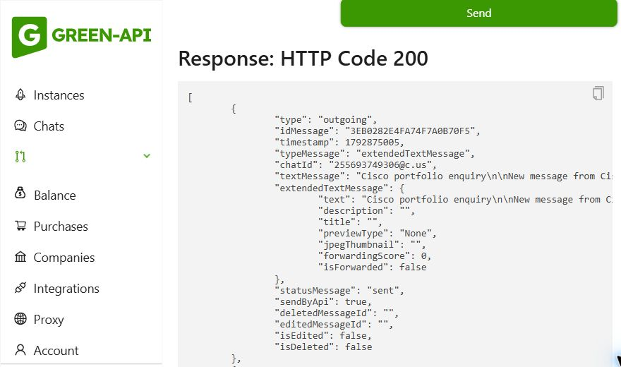

# WhatsApp enquiry notifications

The contact endpoint first delivers the enquiry through Resend. Once Resend returns a message ID, Next.js `after()` sends an additional notification to the configured owner through Green API. Vercel keeps this background task alive after responding to the visitor. The route allows 30 seconds total and the WhatsApp request has a five-second timeout. A WhatsApp failure is logged using a category and optional HTTP status, never a token, provider response body, or enquiry contents. The visitor still receives success for the accepted email.

The WhatsApp message includes the service, visitor name, brief, email, optional phone/company, budget, timing, reply language, and submission reference. It directs the owner to the visitor's contact details. Visitors receive no automatic WhatsApp message. Link previews are disabled, the destination is fixed on the server, and no inbound webhook is needed. The existing validation, honeypot, origin check, body-size limit, and rate limiter run before either delivery.

## Local setup

The owner's authorized Green API instance is connected. Keep these values only in the gitignored `.env.local` and Vercel environment settings:

| Variable                   | Value/source                                                                                                                                       |
| -------------------------- | -------------------------------------------------------------------------------------------------------------------------------------------------- |
| `GREEN_API_URL`            | `https://7107.api.greenapi.com`                                                                                                                    |
| `GREEN_API_INSTANCE_ID`    | `710722779815`                                                                                                                                     |
| `GREEN_API_TOKEN`          | Copy `apiTokenInstance` from the Green API instance page. Never commit it.                                                                         |
| `CONTACT_WHATSAPP_CHAT_ID` | The linked number in international digits, followed by `@c.us`. The configured owner's number ends in 9306. Copy the full value from `.env.local`. |

Keep `RESEND_API_KEY` and `CONTACT_TO_EMAIL` unchanged. The server accepts only HTTPS Green API hosts and a numeric personal WhatsApp chat ID. These are server-side variables: do not add `NEXT_PUBLIC_` prefixes.

Run `npm run dev` and open `http://127.0.0.1:3000/en/contact`. Restart the development server if it has not reloaded `.env.local`. Submit one clearly labeled test enquiry and check the owner's email and the WhatsApp chat with yourself. For messages sent to the linked number itself, Green API documents `sent`/one tick as the expected status; a read receipt is not required.

## Vercel setup when publishing

1. Open the Vercel **portfolio** project, then **Settings → Environment Variables**.
2. Add each of the four variables above, copying the exact values from local `.env.local`. Select **Production**. Select **Preview** too only if preview deployments should send real notifications to the owner.
3. Choose **Secret** for `GREEN_API_TOKEN`. Preserve all existing variables, including the two Resend settings. Do not paste secrets into GitHub source or commit `.env.local`.
4. Save the variables before pushing the code to the production branch. If the code has already been deployed, redeploy the latest deployment: saved variable changes apply to subsequent deployments.
5. After the deployment is ready, submit one labeled test enquiry on the live contact page. Confirm the form succeeds, email arrives, and the WhatsApp notification appears. This setup does not enable incoming-message automation.

The live Vercel project is `iamciscoos-projects/portfolio`, serving `justcisco.business`. Local configuration does not update Vercel automatically.

## Delivery limits and troubleshooting

- No Green API settings means WhatsApp is disabled and existing email delivery works normally. Partial or invalid settings generate a `configuration` warning.
- `idMessage` means Green API queued/accepted the message, not proof that the phone received it. Check **Outgoing messages journal** in Green API for final status.
- Check **Authorized** on the instance page if notifications stop. A disconnected instance can leave accepted messages in its queue for up to 24 hours.
- The instance uses the Developer plan. Its recipient/chat limits apply; using one fixed owner destination avoids sending to arbitrary visitors. A `466` response indicates a plan limit.
- A bounded in-memory map suppresses concurrent/repeated notifications for the same submission within one process for up to 24 hours. It stores only a request hash, expiry, and completion promise. It resets on restart and does not coordinate Vercel instances; duplicate WhatsApp alerts across instances remain possible. The included submission reference identifies duplicates.
- There is no durable retry queue. An unsuccessful WhatsApp attempt is logged, while the accepted email remains the reliable record. Fix the provider/configuration rather than asking visitors to resubmit. A later retry of the same submission may retry a failed WhatsApp attempt.
- Remove all four WhatsApp variables and redeploy to disable alerts without affecting email.

## Local verification, 24 October 2026

- The existing `.env.local` values were preserved and the four WhatsApp settings were appended with owner approval. No secrets were added to tracked source.
- One setup test was sent from the Green API console. A separate, labeled enquiry was submitted through the actual local contact form. The form showed success and the Green API outgoing journal recorded the matching enquiry as `sent` to the linked owner number. Message ID: `3EB0282E4FA74F7A0B70F5`.
- All 81 unit/API tests and three focused browser tests passed. Browser checks covered editable template selection, optional phone validation, and services/templates in all five locales, with provider submissions intercepted.
- Independent code review found no actionable issues. Inverting the provider-success check made the regression suite fail as expected; the source was then restored byte-for-byte and the focused suite passed again.
- ESLint, TypeScript and the production build passed; the build generated 81 routes. The Windows sandbox blocked the native compiler cache on the first build, so the successful build ran with approved access outside that sandbox. No compiler/dependency changes were needed.
- The full dependency audit reported zero vulnerabilities. The live local contact page had no captured console errors or warnings.
- Vercel settings and GitHub were left unchanged; the owner requested local verification and publishing instructions for later.

## Official references

- [Green API SendMessage](https://green-api.com/en/docs/api/sending/SendMessage/): endpoint, response ID, self-message status, queue behavior and text limits.
- [Developer plan limit errors](https://green-api.com/en/docs/api/466-error-example-body/).
- [Vercel environment variables](https://vercel.com/docs/environment-variables): Production/Preview scope, Secret values, and changes applying only to new deployments.
- The installed Next.js `after()` reference is `node_modules/next/dist/docs/01-app/03-api-reference/04-functions/after.md`.
